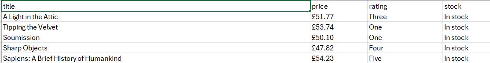

# BOOK-SCRAPER
## About the Project
This project is about how we can change a live webpage into a CSV file by using requests, BeautifulSoup and CSV. The site name is [Books to Scrape](https://books.toscrape.com) and the four facts are title, price, rating, stock which I saved in 'books.csv'.

## How to run it 
On Windows, run these in cmd:
```
git clone https://github.com/bhargavsaideekonda/book-scraper.git
cd book-scraper
python -m venv .venv
.\.venv\Scripts\python.exe -m pip install -r requirements.txt
.\.venv\Scripts\python.exe scraper.py
```
It prints the 20 books and saves them to books.csv in the book-scraper folder.
## why I chose this site
I chose this site as an example for how can we change the code into data.It’s built for scraping that we can freely get data, its HTML is static so we can easily take the data, and it can answer my rating-vs-price question by the code you taken.
## Limitations
It is just page 1 only,it must be run from book-scraper,it breaks if a class name changes and prices and ratings are saved as text.
## What I built myself
- The loop that goes through all 20 books on the page
- The `find` lines that pull out each book's price, rating and stock
- The CSV writing: I adapted the example from the Python csv docs,
  wrote the header row and one row per book
- I found `class_` in the BeautifulSoup docs myself

I built this with step-by-step help from Claude, an AI tutor. It helped
plan the stages, explained the errors, and showed me the fixes for the
£ encoding problems. I typed and ran every line myself.
I am telling this because i did it >.< .